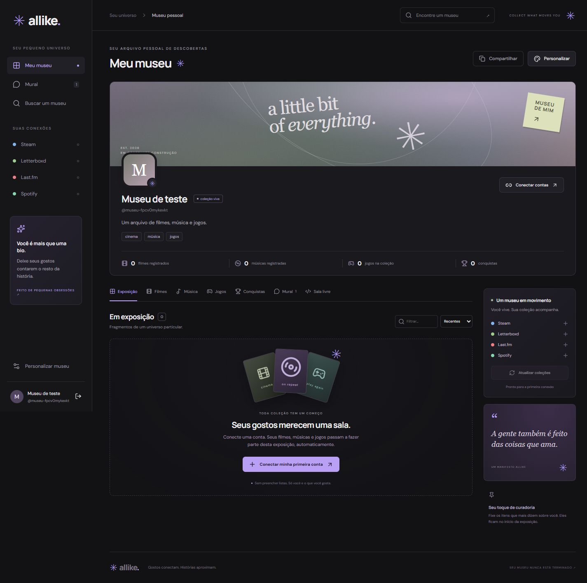

# Allike — seu universo, em exposição

Projeto acadêmico de um museu pessoal de filmes, músicas, jogos e conquistas, com perfis personalizáveis e recursos sociais. Desenvolvido com apoio de inteligência artificial; a proposta e as decisões de produto são do estudante.

**[Abrir o Allike](https://allike.marceloggamer27.workers.dev)** · **[Guia para apresentação ao professor](docs/README-ACADEMICO.md)**



## O que está disponível

- Museu, pesquisa de perfis, fixação de itens e personalização de CSS em área isolada.
- Alli, mascote demonstrativo: obras reais; contas, opiniões e desbloqueios fictícios e identificados.
- Feed cronológico, seguir/deixar de seguir, seguidores e mural persistente.
- Login administrativo, logout e lembre-me no destino independente.
- Chat implementado para duas contas reais. Cadastro multiusuário e confirmação por e-mail dependem de configurar Supabase e envio de e-mails.
- Letterboxd por RSS público, limitado às entradas do feed. Steam e Last.fm dependem de chaves do aplicativo no servidor, ainda não configuradas.

A sincronização é consultada enquanto o museu está aberto; não há rotina agendada com o site fechado. A área Descobrir com Alli oferece afinidade por regras, feedback de interesse, recomendações de obras por IA, conversa e sugestões de bio/tema. Spotify não faz parte desta versão.

Veja [IA, recuperação de senha e limites](docs/IA-E-RECUPERACAO.md). O fluxo de recuperação por e-mail está implementado, mas o envio real depende da configuração do Supabase/SMTP.

## Executar localmente

Use Node.js 24 e npm. Na raiz:

```sh
npm ci
# Crie .dev.vars a partir de .env.example e configure seu próprio acesso.
npm run db:migrate:local
npm run dev:independent
```

Abra http://localhost:5174. O clone não inclui credenciais nem dados de usuários. Consulte [acesso administrativo](docs/acesso-administrador.md), [cadastro por e-mail](docs/CONFIGURAR-CONTA-GRATUITA.md) e [publicação](docs/PUBLICAR-GITHUB-CLOUDFLARE.md).

## Organização

| Caminho | Responsabilidade |
| --- | --- |
| `app/` | Telas TSX, layout HTML, CSS e rotas da API |
| `components/`, `hooks/` | Componentes e utilitários de interface, incluindo base do starter |
| `lib/` | Catálogo, autenticação, sincronização e regras do servidor |
| `db/`, `drizzle/` | Definição das tabelas e migrações SQL |
| `worker/` | Entradas de execução Sites e Cloudflare independente |
| `public/` | Arquivos servidos ao navegador, incluindo arte e créditos do Alli |
| `scripts/`, `tests/` | Ferramentas de execução e verificações |
| `docs/` | Explicação acadêmica, configuração, privacidade e documentação funcional |
| `docs/design/`, `docs/images/` | Notas de design, arte fonte e capturas de apresentação |
| `examples/` | Exemplos de D1 e tema CSS copiável |
| `vendor/` | Dependências vendorizadas e suas licenças |
| `.github/workflows/` | Validação automatizada do código |

`node_modules`, builds, bancos locais, arquivos de ambiente e material temporário são gerados localmente e ignorados pelo Git. O repositório continua público; segredos não pertencem a ele. Leia [privacidade e arquivos locais](docs/PRIVACIDADE.md).

## Tecnologias e verificação

React e TypeScript, CSS com base Tailwind, Vinext/Vite e Cloudflare Workers + D1. Vinext é uma dependência em versão beta; a aplicação acadêmica não implica garantia de prontidão para produção.

```sh
npm run check
npm run test:unit
npm run build:independent
```

A CI do GitHub executa essas verificações. Ela **não publica automaticamente** na Cloudflare. Testes de integração em `tests/*smoke.mjs` exigem ambiente local e o provedor compatível; não devem ser executados contra dados de produção.

## Leia também

- [Explicação de HTML, CSS, JavaScript e TypeScript](docs/README-ACADEMICO.md)
- [Comportamento e limites dos recursos](docs/REFERENCIA-FUNCIONAL.md)
- [Publicar e configurar o banco independente](docs/PUBLICAR-GITHUB-CLOUDFLARE.md)
- [Design do Alli](docs/design/ALLI-DESIGN.md) e [fontes das obras](docs/alli-fontes.json)
- [Exemplo de personalização CSS](examples/themes/alli-sala-livre.css)

A versão original do Sites é um destino separado. O endereço acima usa a conta Cloudflare do mantenedor e banco D1 próprio.

### Coleções e visitas públicas

Em Personalizar, “Permitir visitas sem login” torna o museu acessível pelo link. Nome, bio, interesses, coleção e CSS são públicos; chats, sessões e credenciais não são enviados aos visitantes. Comentários e interações exigem login.

A Steam usa OpenID para vincular a identidade, mas a importação exige uma Steam Web API key do mantenedor. No painel Conexões → Steam, o administrador pode validar e salvar a chave criptografada no D1. TOKEN_SECRET deve permanecer estável para descriptografá-la. Jogos e horas são salvos primeiro; conquistas são consultadas em lotes de oito jogos com tempo registrado, continuando enquanto o museu estiver aberto. Detalhes de jogos e conquistas devem estar públicos na Steam.

Letterboxd: o RSS traz registros recentes, não toda a lista de assistidos. Em Conexões → Letterboxd, importe watched.csv, ratings.csv, diary.csv e reviews.csv da exportação oficial (extraia o ZIP antes). Limites: 2 MB e 5.000 registros por arquivo, enviados em lotes de 200 linhas. Um cartão por filme combina nota e review recentes; reimportar preserva itens fixados. CSVs não contêm capas. O RSS continua atualizando novas entradas, mas registros antigos ausentes do RSS exigem outra exportação.

A coleção usa paginação de 60 itens, pesquisa no servidor e ordenação de jogos por horas. O CSS fica isolado em iframe sem scripts, com prévia no perfil e exposição ampliada na Sala livre. Migração necessária: 0004_library_visibility.sql.

### Leitura pública do Letterboxd

A sincronização também consulta a página pública /films/, uma página por lote, lendo notas e curtidas e preservando o que já foi salvo se houver bloqueio ou mudança no HTML. Datas de visualização desconhecidas não são inventadas. O RSS segue responsável por novas entradas do diário/reviews. Essa leitura de HTML não é uma API oficial e pode deixar de funcionar; o painel informa disponibilidade parcial. Não resolve desafios, não usa cookies privados nem contorna bloqueios.

A vitrine profile_favorites guarda favoritos observados no perfil público, com data de consulta. É uma captura explicitamente identificada, não uma sincronização automática dos quatro favoritos. Favoritos não são contados como filmes assistidos. Os arquivos pessoais observados para importação ficam em work/ (ignorado pelo Git); não são incluídos no código público.
