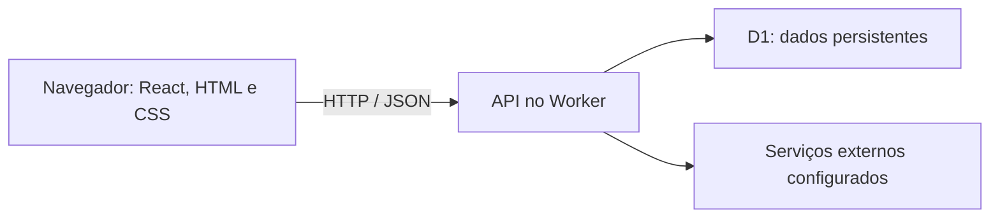

# Allike — guia de estudo e apresentação

Este documento explica o código existente. Não substitui estudar, executar e alterar o projeto. A implementação teve participação significativa de IA; não seria correto apresentar todo o código como escrito manualmente pelo estudante.

## 1. Proposta e escopo

O Allike reúne gostos culturais em um museu pessoal: filmes, músicas, jogos e conquistas. O público imaginado gosta de descobrir afinidades e expressar sua identidade visual. O mascote Alli demonstra esse conceito com obras reais e uma personalidade fictícia.

O foco acadêmico é a interface: estrutura, estilo, interação e consumo de dados. O projeto também contém servidor e banco, que dão persistência às interações. O feed atual é cronológico; a descoberta por afinidade agora compara tags e obras por regras explícitas; respostas criativas usam Workers AI.

## 2. Onde está o HTML?

Não existe uma página principal escrita como um grande `index.html`. React descreve a interface em JSX, dentro de arquivos `.tsx`. O resultado é HTML no navegador.

[app/layout.tsx](../app/layout.tsx) define `<html lang="pt-BR">` e `<body>{children}</body>`, importa o CSS global e informa metadados. [app/page.tsx](../app/page.tsx) renderiza o componente Museum:

```tsx
import Museum from './museum';
export default function Home() {
  return <Museum />;
}
```

[app/account.tsx](../app/account.tsx) usa elementos como `main`, `section`, `form`, `label`, `input` e `button`. Eles organizam conteúdo e interação. Os campos têm atributos como `required`, `autoComplete` e `type="password"`. Imagens têm texto alternativo; erros usam `role="alert"`.

No JSX, `className` define a classe CSS; chaves inserem expressões JavaScript. Um componente é uma função que retorna a descrição da interface. A marcação semântica ajuda acessibilidade, mas não representa uma auditoria completa de acessibilidade.

**Para demonstrar:** inspecione o formulário no navegador e localize o elemento HTML correspondente no TSX.

## 3. Como o CSS organiza o visual?

[app/globals.css](../app/globals.css) contém estilos globais, cartões, layout do museu, formulários, chat, tema do Alli e regras responsivas. Há CSS autoral além da base de ferramentas do starter.

Exemplo real, apenas formatado para leitura:

```css
.account-layout {
  display: grid;
  grid-template-columns: 1fr 1fr;
}
@media (max-width: 760px) {
  .account-layout {
    grid-template-columns: 1fr;
  }
}
```

Grid distribui duas colunas no espaço disponível. A media query muda para uma coluna em telas menores. Flexbox aparece em grupos de botões e conversas. Cores, espaçamento, bordas e tipografia criam hierarquia visual; seletores e cascata determinam qual regra se aplica.

O tema do mascote mostra uma identidade própria. [examples/themes/alli-sala-livre.css](../examples/themes/alli-sala-livre.css) é um exemplo copiável. O CSS fornecido pelo usuário é exibido em iframe isolado sem scripts; ele não recebe liberdade para executar JavaScript na página principal.

**Para demonstrar:** altere o espaçamento de um cartão, explique a classe usada e confira a versão estreita no navegador.

## 4. O que JavaScript faz?

JavaScript trata eventos, guarda estado de interface e conversa com a API. React usa esse estado para atualizar a tela.

No formulário de [app/account.tsx](../app/account.tsx), o lembre-me usa `useState(false)`. O checkbox lê `remember` e seu evento `onChange` chama `setRemember(e.target.checked)`. A atualização provoca uma nova renderização.

A função `submit` usa `fetch` com POST para `/api/auth/` mais a ação escolhida, enviando JSON. `async/await` aguarda a resposta. `try/catch/finally` trata sucesso, erro e liberação do estado de carregamento. O envio do formulário chama `preventDefault()` para evitar a navegação padrão.

`useEffect` consulta o estado da autenticação ao montar a tela. Nas telas sociais também há consultas periódicas: o chat usa polling, não WebSocket.

**Para demonstrar:** mostre a requisição na aba Network do navegador, sem projetar senha, cookies ou tokens.

## 5. Por que TypeScript e TSX?

TypeScript acrescenta tipos ao JavaScript. Em [app/account.tsx](../app/account.tsx), o tipo `Status` descreve a resposta esperada: configuração, provedor, usuário e sessão. `useState<Status | null>(null)` permite representar tanto a resposta quanto o momento anterior ao carregamento.

TSX combina tipos com JSX. O processo de compilação remove os tipos; o navegador executa JavaScript. Tipos ajudam a detectar inconsistências durante desenvolvimento, mas não validam automaticamente os dados vindos da rede. O servidor precisa verificar entradas e permissões em tempo de execução.

Há usos de `any` no código: são pontos de menor proteção de tipos e oportunidades de melhoria, não prova de tipagem perfeita.

## 6. Interface, servidor e banco



| Parte | Arquivos para estudar | Responsabilidade |
| --- | --- | --- |
| Interface | [museum.tsx](../app/museum.tsx), [account.tsx](../app/account.tsx), [chat.tsx](../app/chat.tsx) | Eventos, carregamento, mensagens e apresentação |
| API | [route.ts](../app/api/%5B...path%5D/route.ts) | Receber pedidos, verificar acesso e executar operações |
| Autenticação | [account.ts](../lib/account.ts), [server.ts](../lib/server.ts) | Identidade, sessões e apoio ao servidor |
| Integrações | [sync.ts](../lib/sync.ts), [catalog.ts](../lib/catalog.ts) | Importar e normalizar dados |
| Persistência | [schema.ts](../db/schema.ts), [drizzle](../drizzle/) | Tabelas e evolução do banco |
| Demonstração | [demo.ts](../lib/demo.ts) | Perfil fictício do Alli e curadoria real |

Estado React é temporário e controla a tela. Dados gravados no D1 sobrevivem a recarregar a página. O front-end não acessa o banco diretamente nem recebe segredos do servidor.

Exemplo de fluxo: a pessoa marca lembre-me, envia o formulário, a API valida as credenciais e cria uma sessão. O navegador recebe cookie HttpOnly; a aplicação consulta o usuário autenticado. No logout, a sessão é revogada no servidor. Esconder um botão na interface não substitui autorização na API.

## 7. O que apresentar como pronto e como pendente

- Pronto no destino independente: acesso administrativo, saída, lembre-me, museu e dados persistentes; Alli usa filmes, músicas e jogos reais.
- Implementado: feed cronológico, seguidores, mural e chat. Para demonstrar chat entre pessoas, é necessário configurar o provedor multiusuário e ter duas contas.
- Cadastro e confirmação por e-mail: preparados, aguardando configuração real do Supabase e envio de e-mails.
- Letterboxd: RSS público, sem garantir histórico completo ou comprovar propriedade da conta.
- Steam e Last.fm: integração depende de chaves do aplicativo no servidor; não está ativada apenas por existir uma tela de conexão.
- Descoberta implementada: comparação de tags/obras e feedback de interesse/desinteresse, sem aprendizado de máquina. IA generativa para conversa, curadoria limitada e bio/tema.
- Não implementado: sincronização agendada com o site fechado, bloqueio/denúncia e moderação.

As obras do Alli são reais. Suas contas externas, opiniões, atividades e desbloqueios são demonstrações fictícias. Não representam importações de contas reais do mascote.

## 8. Roteiro sugerido para 5–8 minutos

1. Explique o problema e o público do museu cultural.
2. Mostre o perfil Alli e a diferença entre catálogo real e personagem fictício.
3. Mostre a interface em uma largura grande e pequena.
4. Abra o formulário de conta e identifique HTML, classe CSS, estado e evento.
5. Faça uma pequena alteração visual que você consiga explicar e confira o resultado.
6. Explique uma requisição até a API e o banco.
7. Apresente os limites atuais e declare a participação da IA.

Não exponha credenciais no projetor. Prepare o acesso e a conexão antes da aula.

## 9. Perguntas para verificar seu entendimento

- Por que usar `button` em vez de uma `div` clicável?
- Qual a diferença entre Grid, Flexbox e media query?
- O que muda quando `setRemember` é chamado?
- Por que `await fetch` precisa de tratamento de erro?
- Por que TypeScript não garante que uma resposta externa seja válida?
- O que se perde ao recarregar a página e o que permanece no D1?
- Por que uma chave de API não deve estar no código enviado ao navegador?
- Como o servidor impede que uma pessoa edite o museu de outra?
- Por que o feed atual não é um sistema de recomendação?

Se não conseguir responder, localize o trecho e teste antes de apresentar.

## 10. Participação da IA e autoria

Uma declaração honesta possível, ajustada ao que você realmente fez:

> A ideia e as decisões de produto foram minhas. Usei IA extensivamente para apoiar a implementação, documentação e depuração. Estou estudando o código e consigo demonstrar as partes que apresento. Distingo os recursos implementados das configurações ainda pendentes.

Não afirme que escreveu ou compreendeu tudo se isso ainda não aconteceu. Siga a política da disciplina sobre IA e registre suas próprias alterações e aprendizados. Um projeto maior não substitui domínio dos fundamentos; explicar bem uma parte concreta vale mais do que prometer domínio de toda a aplicação.

## Atualização: IA e recuperação

Leia [o guia de implementação](IA-E-RECUPERACAO.md). Explique a diferença entre pontuação por regras e geração por modelo. A recuperação exige código do provedor, não apenas saber o e-mail. Temas gerados passam por validação e confirmação antes de substituir o CSS.
